
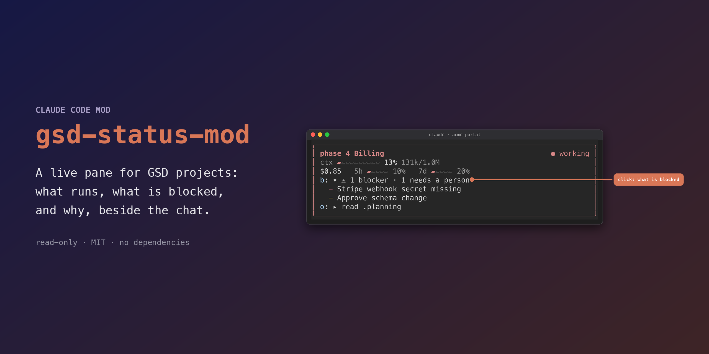

<h1 align="center">gsd-status-mod</h1>

  
  
  
  

A live dashboard for [GSD](https://github.com/open-gsd/gsd-core) projects, as a Claude Code mod: the roadmap with the
current phase marked, an agent tree with forks and sub-agents and live clocks, context and cost, blockers and what needs a
person, work streams, and a built-in markdown reader for `.planning`.

> [!NOTE]
> **Read-only.** It reads `.planning/` and the git reflog, writes no files, runs no processes and makes no network calls.
> It draws nothing outside a GSD project. No dependencies. Details: [What it can touch](#-what-it-can-touch-reach).

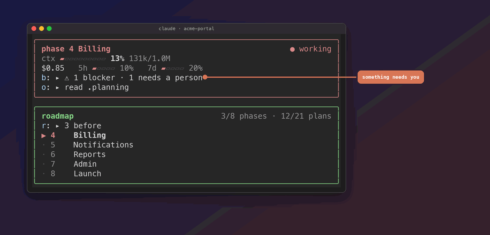

From "1 needs a person" to the plan that names the blocker, and back. Pace, trends and the timeline are in the screenshots below.

## 📥 Install

Claude Code 2.1.287 or later:

    claude plugin marketplace add helenkwok/gsd-status-mod
    claude plugin install gsd-status-mod@helenkwok-mods

After that it loads in every session, with no flag. Update with `claude plugin update gsd-status-mod@helenkwok-mods`;
remove with `claude plugin uninstall gsd-status-mod@helenkwok-mods`. Add `--scope project` to install it for one project
only. To try it without installing, see [Try it from a clone](#-try-it-from-a-clone).

## ✨ Features

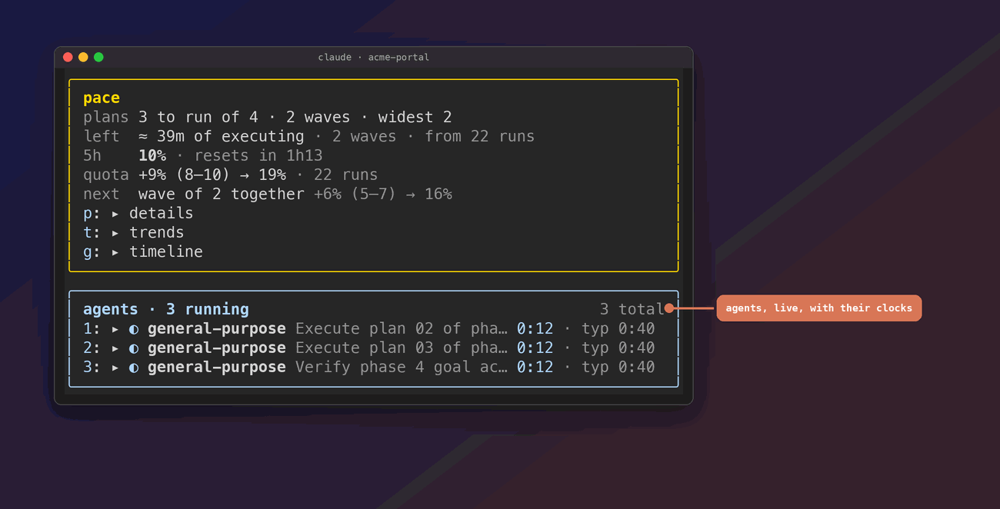

Agents with live clocks and typical times, then <code>p</code> pace details, <code>t</code> trends, <code>g</code> timeline.

- **Live pane**: main box (context, cost, limits, blockers), roadmap, pace, agents, last turn, work streams, session log.
- **Pace and fit**: how the phase's plans run in waves, how long the rest should take, and how far it should take the
  5-hour window.
- **History, trends and timeline**: numbers-only records of past agents, typical times beside running clocks, three
  trend charts, and a bar per agent over the latest working stretch.
- **Markdown reader** for `.planning`: browse any depth, follow links between plans, contents list, header hidden.
- **Reader links in the transcript**: under tool rows and replies that name a `.planning` markdown file.
- **`GSD ·` line** above the prompt, with a drift warning when `STATE.md` is behind the commits.
- **`next:` hint** and a **Tab suggestion** from the handoff's next action.
- **`/gsd-status`**: the full resume report on demand. **`/gsd-board`**: open or close the pane.
- **Toasts**: an agent far over its usual time, a phase that will not fit the window, drift appearing.
- **Workstream mode** and **git worktrees**.

## 🕹️ Using the pane

Everything with a `▸` is clickable. With the pane focused (`ctrl+x`, then `Tab`) these keys work too:

| Key | Where | What it does |
| --- | --- | --- |
| `1`-`6` | agents | Open or close that agent row |
| `b` | dashboard | Blockers and what needs a person |
| `b` | reader, trends, timeline | Back |
| `r` | dashboard | The whole roadmap |
| `p` | dashboard | Pace details |
| `t` | dashboard | Trends |
| `t` | reader | Back to top |
| `g` | dashboard | Timeline |
| `w` | dashboard | Switch workstream (when there are several) |
| `o` | dashboard | Read `.planning` |
| `d` | reader | Back to the dashboard |
| `c` | reader, in a file | Contents |
| `f` | agents | All agents, finished ones included |
| `l` | session log | Earlier entries |

| Command | What it does |
| --- | --- |
| `/gsd-status` | The full resume report, read fresh from disk |
| `/gsd-board` | Open or close the pane |

## ⚙️ Settings

Set with `/plugin configure gsd-status-mod@helenkwok-mods`.

| Option | What it does | Default |
| --- | --- | --- |
| `openOnStart` | Open the pane when a session starts in a GSD project. `/gsd-board` opens it later either way. | `true` |
| `toasts` | Short notices: an agent far over its usual time, a phase that will not fit the 5-hour window, `STATE.md` drift. | `true` |

## 🧠 How each part works

### The live pane

Docked on the right of a wide terminal (144+ columns). Bordered boxes that update as events happen, not only per turn.

- *main*: context gauge, session cost, 5h and 7d limits, blockers and people-needed from the handoff. The cost is
  whatever Claude Code reports for the session, shown as is; it is an estimate, not a bill.
- *roadmap*: the phase checklist from `ROADMAP.md` with the current phase marked. The current phase comes from
  `STATE.md` (its `current_phase`, or the label that starts `current_phase_name`); it is never guessed, so a project
  whose state names no phase shows the list with no marker. Only `- [x] **Phase N: name**` lines are read.
- *pace*: how the current phase's plans are laid out to run (plans left, waves, the widest wave) and where this
  session's agent time went (share by agent type, and how parallel the executors ran, 1.0 being one at a time). It
  says "serial" only on clear evidence: plans left in single-plan waves, or two or more executors that ran one at a
  time. Plans come from `wave:` in the phase's `*-PLAN.md` frontmatter; a plan with a `NN-MM-SUMMARY.md` is done.
  `p` shows the wave-by-wave list, this phase's time by stage, and the time by type.
- *agents*: a tree of running and finished agents, with forks (`⑂`) and sub-agents under their parent, and a live
  clock. Finished agents fold away while others run; `f` opens the whole tree, every agent and its full description.
- *last turn / turn*, *work streams* (counts and newest of phases, spikes, threads, todos, seeds, notes; an open stream
  lists its five newest, and `▸ all N in the reader` opens its folder) and a *session log* of prompts, spawns, errors and
  new commits (the last 40, all shown when opened).

The band above the prompt is hidden while the pane is open, so the same line is not drawn twice.

### History, fit, trends and timeline

*History:* each finished agent leaves one small record, kept in the plugin's own store across sessions (the last 300 per
project): type, phase, duration, number of model responses, token counts and model. No description, no prompt, no text.
With five or more past runs of a kind, a running agent's clock shows `typ 0:20` beside it, in amber once it is over twice
the typical. History starts from the day you update; it is per project and never read from transcripts.

*Fit:* with three or more past executor runs, a `left` line says how long the phase's open waves should take (one typical
executor run per wave, so plans that can run together count once), the `5h` line gives the window and when it resets, and
the `quota` line adds how far the rest of the phase should take the window. Quota is measured, not guessed: while
executors run, the plugin notes how far the 5-hour window rose and divides it by how many ran together, so a single
executor and a wave of three both give a per-executor figure. It needs five such measurements, shows a range (the middle
half of them), and leaves out any stretch with a reviewer or planner in it or where the window reset. The account is
shared with the main conversation and other sessions, so read it as a range. When the next wave runs plans together, a
`next` line shows what that wave alone should add.

*Trends* (`t`): executor time per run (a sparkline of the last 30), time by phase split into planning, executing and
checking, and agent time per day for 14 days, each with its numbers beside it.

*Timeline* (`g`): one bar per agent over the latest working stretch (until a gap of 30 minutes, at most 12 agents, running
ones shaded): agents that ran together sit on top of each other and agents that ran one after another form a staircase,
with the executors' parallelism underneath.

### The markdown reader

`o: ▸ read .planning` (or any entry under *work streams*) swaps the dashboard for a browser of `.planning`, one folder at a
time (so any depth), and then for the file itself, drawn by Claude Code's own `Markdown` element: the same typography as a
reply, at the pane's width, scrolled with the wheel or `PageDown`/`End`.

- The YAML header is hidden, `- [x]` shows as `✓` and `- [ ]` as `○`, and a relative link to another `.md` file under
  `.planning` opens it.
- A folder lists all its entries. `b` goes back one level, `d: ⌂ dashboard` returns to the dashboard from any depth, and
  `t: ↑ back to top` ends every file and every folder of more than 30 entries.
- A file with three or more headings gets `c: ▸ contents`: a list of its headings (all of them, levels 1 to 3) that jumps
  to one.
- Only `.planning` is readable. A path opens only if its real location, symlinks followed, is still under `.planning`'s
  own, so a symlink inside `.planning` cannot lead the reader elsewhere.

**Reader links in the transcript** (fullscreen terminal only, where clicks reach a mod):

- A Read, Write or Edit of a `.planning` markdown file gets a line under its tool row, `open in the GSD reader`, that
  opens the pane on that file.
- A reply that names `.planning` markdown files gets the same line under it, one link per file: `.planning/...` paths,
  paths relative to `.planning` (`phases/04-x/04-01-PLAN.md`), absolute and Windows paths into it, and a bare file name
  when exactly one file has it. Only files that exist are linked; the reply itself is drawn as written. Claude Code
  2.1.296 leaves paths in replies as plain text ([#79839](https://github.com/anthropics/claude-code/issues/79839)).

### The band, the hint and the suggestion

    GSD · stopped: PAUSED 2026-09-09 after the schema review · 9/14 phases  ⚠ ~124 commits since STATE.md   <- above the prompt
    ❯ /gsd-execute-phase 2                                                                                          <- dim suggestion, Tab to take
    ⏵⏵ auto mode on (shift+tab to cycle) · next: Run /gsd-execute-phase 2 · handoff 5d ago                          <- end of the line under the prompt

Each shows what the GSD statusline does not.

- **`GSD ·` line** (above the prompt): shown only for a GSD project (a `.planning/STATE.md` whose frontmatter has
  `gsd_state_version`). `stopped_at` cut to its first sentence, plus phases done. It never repeats `status` or the plan
  counts, which the GSD statusline already shows, and it shows no age: STATE.md's `last_updated` is touched without the
  content changing.
- **`⚠ ~N commits since STATE.md`**: on that line, when the commit in `state_head` is 5 or more commits behind this
  clone's HEAD, so you know STATE.md is stale. Counted from the git reflog, so approximate (it undercounts: 124 against
  217 from `git rev-list` on one repo); hidden when `state_head` is absent or not in the reflog.
- **`next:` hint** (end of the line under the prompt): `next_action` from `.planning/HANDOFF.json`, with the handoff's
  own age. It is added as a dim tail, so the engine's line and its pills stay, and it is hidden while you type or while a
  turn runs. GSD deletes the file after a resume, so it goes away when it is no longer needed.
- **Tab suggestion** (the empty prompt box, once at session start): only when the text shown in the `next:` hint names a
  command. It offers that command, plus a phase number or version if one follows (`/gsd-execute-phase 2`), so it always
  matches the hint beside it. Prose-only actions (`Nothing is pending`) and actions that say to go elsewhere (`Open a
  session in ~/other-project and run ...`) get no suggestion. Tab only fills the box; nothing runs until you press Enter.
  The engine proposes its own suggestion after each turn, so ours shows at session start only.
- **`/gsd-status`**: the full resume report on demand, read fresh from disk, with no terminal-height limit. Phase and
  status, phase and plan progress, the whole `stopped_at`, the drift warning, and from `HANDOFF.json` the next action and
  its command, blockers, `human_actions_pending` ("Needs a person"), remaining tasks and how many files were uncommitted
  at pause. In a project that is not GSD it says so.

The band does not show plan usage (5-hour / weekly limits), since `quota-meter` and `limit-watch` already do; the pane's
main box does show them, for the one-glance view.

### Toasts

Short notices, each said once: an agent that has run more than twice its typical time, the rest of the phase getting
tight against the 5-hour window (about 90% or more by the end, or the work outlasting the window when quota is not
measured yet), and drift appearing between `STATE.md` and the commits. Turn them off with the `toasts` option.

### Workstream mode and worktrees

When `.planning/STATE.md` is missing but `.planning/workstreams/<name>/STATE.md` exists, the pane reads that workstream's
`STATE.md`, `ROADMAP.md` and work streams, plus the project-wide folders left at `.planning/` (threads, spikes, seeds...),
merged into the same counts (and its `HANDOFF.json`, else the top-level one). GSD's own choice of active workstream is per
session and a mod cannot see it, so the plugin uses the name in `.planning/active-workstream` if there is one, else the
workstream whose `STATE.md` changed most recently. With more than one, a `w: ⇄ workstream …` button (click, or `w`)
switches to the next. The workstream name shows in the header.

In a linked git worktree with no `.planning` of its own, `.planning` is read from the main checkout. Everything follows a
`.planning` symlink and draws nothing when there is nothing to show. The band and hint refresh at session start and after
each turn; the pane also refreshes on tool calls and agent events.

## 📸 Screenshots

All images come from a made-up demo project (`acme-portal`), captured from a live Claude Code session and drawn to PNG from
the terminal text; the window frame and the orange notes are added. The history behind the pace box, trends and timeline is made up; the 5h and 7d figures are the demo
session's own.

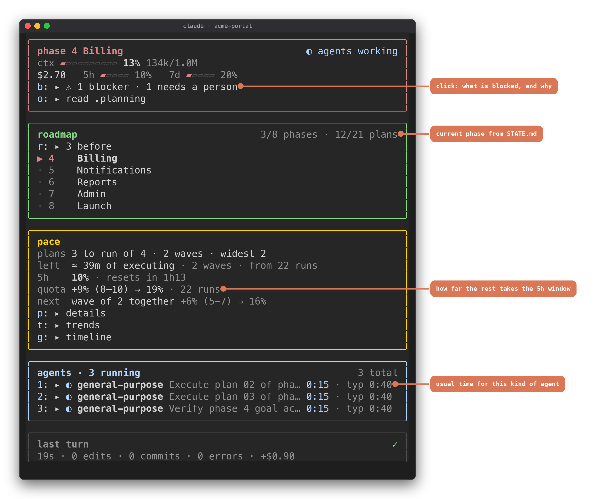

The pane: main box, roadmap, pace, agents with a typical time beside each running clock, and the last turn.

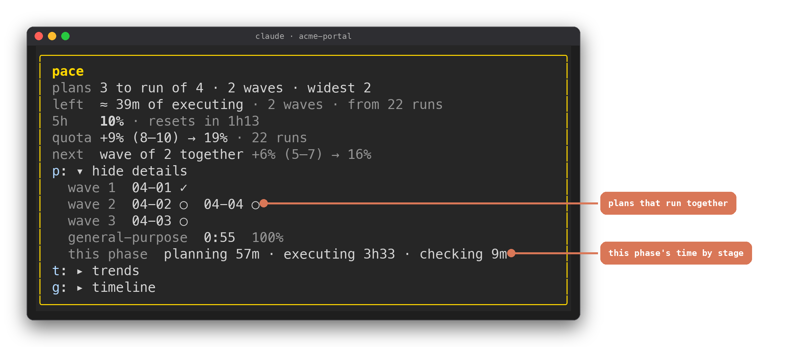

`p` opens the pace details: waves, time by agent type, and this phase's time by stage.

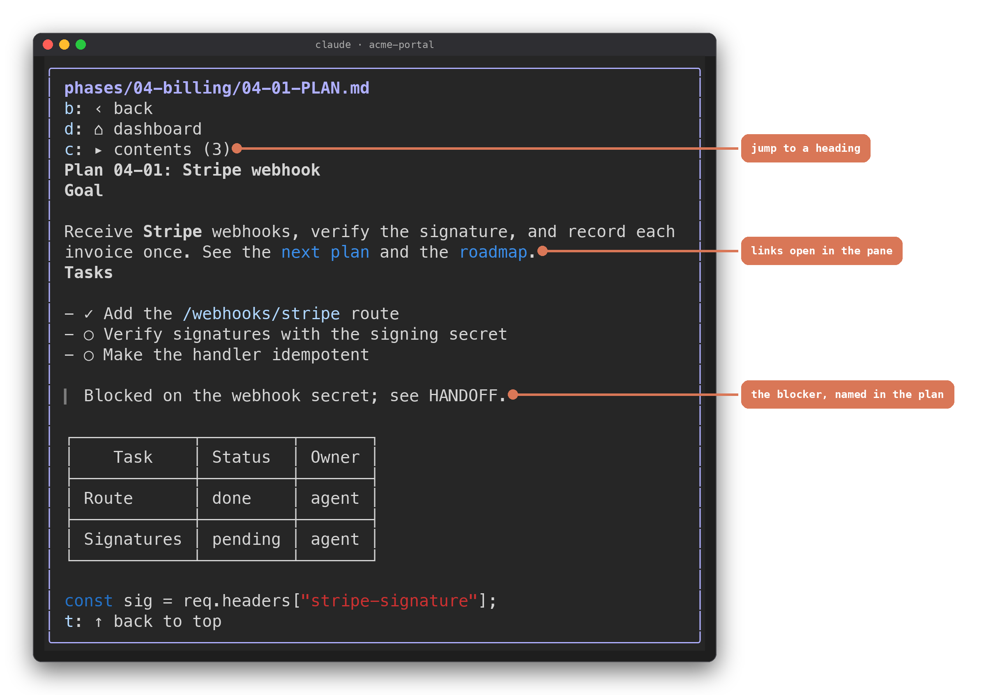

The reader on a phase plan: header hidden, tasks as `✓` and `○`, blue links open the next plan and the roadmap.

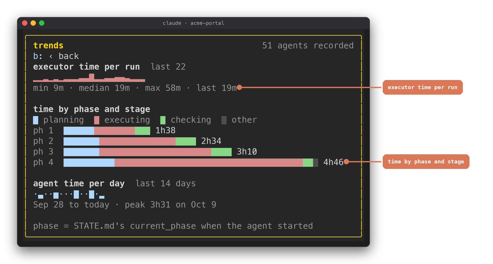

`t` opens the trends: executor time per run, time by phase and stage, agent time per day.

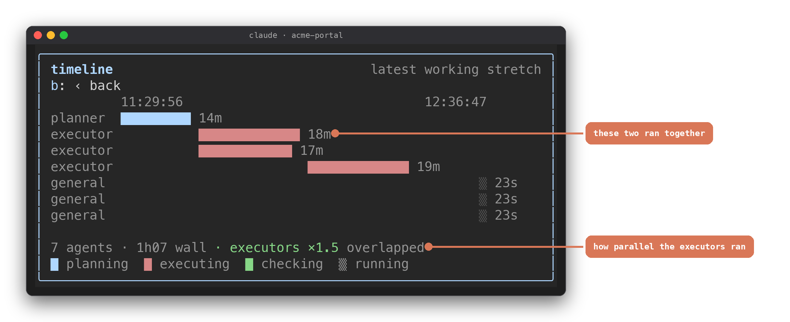

`g` opens the timeline: two executors overlapped, the third waited for them.

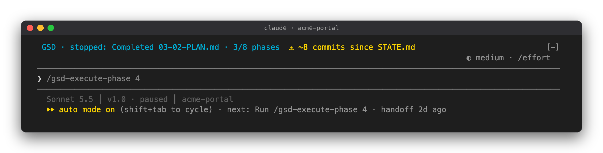

A handoff that names a command: the `GSD ·` line with drift, the Tab suggestion, and the `next:` hint. (The model,
statusline and `auto mode` text are Claude Code's and GSD's own.)

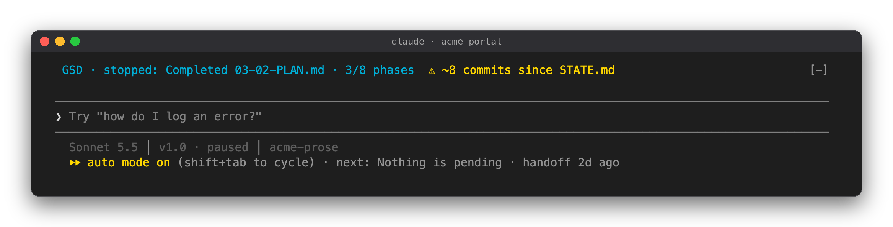

A handoff with no command: the hint shows, and the prompt box keeps Claude Code's own placeholder.

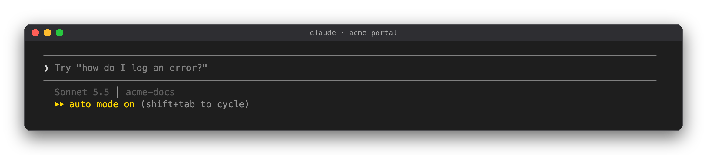

Not a GSD project (no `gsd_state_version`): nothing is added.

## 🔒 What it can touch (reach)

Read-only, and nothing leaves the machine:

- **Files** (`$.fs.read`, `$.fs.list`, `$.fs.stat`): any `.md` under `.planning/` the reader opens (only when you click
  it) or a reply names (to check it exists), and `.planning/STATE.md`, `ROADMAP.md`, `HANDOFF.json`, the entry names in
  `.planning/phases`, `spikes`, `threads` and the other work-stream folders, and the git reflog (`.git/logs/HEAD`, or the
  worktree's git dir named in a `.git` file). Paths resolve from the session root (`$.session.root`), not the current
  folder, so a Bash `cd` does not lose the project.
- **Session data**: `$.session.usage` (context, cost, limits), `$.agent.list` (the live agents), `$.store.get` / `$.store.set` (the history
  above, in the plugin's own store) and `$.clock.now` / `$.clock.every` / `$.clock.sleep` (a 1-second redraw timer, active only while
  something runs and the pane is open, and short waits before a scroll).
- **UI**: `$.ui.open`, `$.ui.close`, `$.ui.invalidate`, `$.ui.scroll`, `$.ui.resolve` and `$.ui.toast` for the pane, band and toasts,
  `$.command.register` for `/gsd-status` and `/gsd-board`, and `$.prompt.suggest` (a dim suggestion in the empty prompt
  box: it cannot send anything).
- **Hooks it listens to**: `session.start`, `turn.start`, `turn.step`, `turn.complete`, `tool.call` and `agent.spawn` (to
  count edits and errors, count an agent's responses and record how long it ran, and note forks; it never changes or
  blocks a call), `command.run`, `ui.render` and `ui.close`.

It writes no files, runs no processes and makes no network calls. Check it yourself:
`claude plugin validate .claude-plugin/plugin.json` prints the hooks and the `$` calls the module makes.

## 🧩 Compatibility with other mods

Tested on Claude Code 2.1.288 with `quota-meter` and `limit-watch` loaded together with this plugin: all three load
without errors and each draws in its own place (they use the pinned status line and a pane; this uses the `AbovePrompt`
band).

The `AbovePrompt` band and the hint line are shared. This plugin keeps whatever other mods draw there: it draws what is
below it in the chain and puts its line on top, and it appends its hint tail after another mod's tail. A mod that answers
without calling `next` hides every mod after it in load order; if such a mod loads before this one, its band is the only
one shown, and that is the other mod's behaviour.

## 🧪 Try it from a clone

Needs Claude Code 2.1.287 or later (`claude --version`) and Node 20+ only if you want to run the tests. There is nothing
to build or install: the plugin is loaded from its folder for one session.

    git clone https://github.com/helenkwok/gsd-status-mod ~/gsd-status-mod
    cd <a GSD project>        # it reads .planning from the folder you start claude in (or its main checkout, in a worktree)
    claude --plugin-dir ~/gsd-status-mod

To check the plugin itself: `cd ~/gsd-status-mod`, then `claude plugin validate .` (the marketplace file),
`claude plugin validate .claude-plugin/plugin.json` (the hooks and `$` calls) and `node --test tests/*.test.mjs`. The
tests include a README check: every key, command, option and image the code has must be in this file.

## ❓ FAQ

**The pane does not show.** It needs a GSD project (`.planning/STATE.md` with `gsd_state_version`, or a workstream) and a
terminal at least 144 columns wide. `/gsd-board` opens it.

**The `GSD ·` line above the prompt is missing.** It is hidden while the pane is open, and the engine drops it in a
terminal under about 16 rows. The hint tail and the suggestion are unaffected.

**A link under a reply or tool row does nothing.** Clicks reach a mod only in Claude Code's fullscreen terminal.

**Does it work on Windows?** The pane has been used in a workstream project on Windows; the other features have not been
tried there.

## 🚧 Not handled yet

A session in a worktree shows the main checkout's `.planning`, which is wrong if that worktree is on a different phase.
Background: open-gsd/gsd-core#5174 (a maintainer asked to revisit in-tree support in November 2026; this plugin is the
out-of-tree route).

## 📝 Changelog and license

Release notes: [CHANGELOG.md](CHANGELOG.md). MIT, see [LICENSE](LICENSE). Not affiliated with Anthropic.
